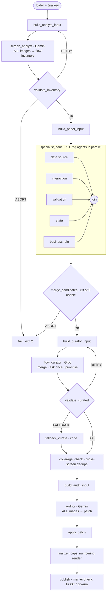

# AnnoQ — Flow-to-Questions pipeline

Turns a **folder of screen images (one flow = one Jira ticket)** into **one Jira comment** with a small, deduplicated
set of business-logic questions for `@product team` / `@tech team` / `@design team`. It replaces the
"annotator interrogates Product/Tech/UX on a call" step before the Figma → React pipeline.

- **8 LLM calls per run** (2 Gemini vision + 6 Groq text), hard cap 9, independent of the number of screens.
- **Ask once:** anything repeated across screens (address block, order summary, header, tab bar) is asked once, as a
  *Common* question with an "applies to" screen list.
- **Google ADK 2.0 graph `Workflow`**, Jinja2 prompts, pydantic validation, deterministic post-processing.

Design and contract: [docs/architecture.md](docs/architecture.md) · [docs/spec.md](docs/spec.md) ·
task log: [docs/tasks.md](docs/tasks.md).

## How it works



Everything that does not need reasoning is plain Python (`src/postprocess.py`): validation, cross-screen dedupe,
coverage, fallback, caps, numbering, rendering, posting. Print the live graph with `python -m src.workflow flows/shopping`.

## Setup

```bash
uv venv && uv pip install -r requirements.txt      # or: python -m venv .venv && pip install -r requirements.txt
cp .env.example .env                                # fill keys, models, Jira
pytest -q                                           # offline: no network, no API keys
```

`.env` essentials:

| Key | Meaning |
|-----|---------|
| `VISION_MODEL` | Gemini model for the analyst + auditor (must start with `gemini`) |
| `TEXT_MODEL` | Groq model for the 5 specialists + curator (must start with `groq/`) |
| `MODEL_ANALYST` / `MODEL_AUDITOR` / `MODEL_SPECIALISTS` / `MODEL_CURATOR` | optional per-agent overrides |
| `GOOGLE_API_KEY`, `GROQ_API_KEY` | provider keys |
| `JIRA_BASE_URL`, `JIRA_EMAIL`, `JIRA_API_TOKEN` | Jira Cloud (Basic auth); optional in `--dry-run` |
| `JIRA_ISSUE_KEY`, `FILE_PATH` | defaults for `--jira-id` / `--file-path` |

Models used so far (verified 2026-11-17): development `gemini-3.1-flash-lite` + `groq/openai/gpt-oss-20b` (cheap);
demo `gemini-3-flash-preview` + `groq/openai/gpt-oss-120b`. Swap them in `.env` only.

## Run

```bash
python run.py --file-path flows/shopping --jira-id PROJ-123 --dry-run   # everything except the POST; prints the comment
python run.py --file-path flows/shopping --jira-id PROJ-123             # posts ONE comment (skips if already posted)
python run.py --file-path flows/shopping --jira-id PROJ-123 --force     # post again even if the marker exists
python run.py                                                           # FILE_PATH + JIRA_ISSUE_KEY from .env
python run.py --file-path flows/single_screen/01_product_details.png --dry-run   # a single image = 1-screen flow
```

- **Input:** PNG/JPG/JPEG/WEBP, natural filename order = flow order (`01_cart.png`, `02_shipping.png`, …), at most
  `MAX_SCREENS` (8). Images are downscaled to `MAX_IMAGE_EDGE` (2000 px).
- **Output:** `outputs/<KEY>_<timestamp>/` → `comment.txt`, `questions.json`, `flow_inventory.json`,
  `candidates.json`, `curated.json`, `audit.json`, `run_report.json` (calls, models, seconds, tokens, warnings).
- **Exit codes:** `0` done (posted / dry-run / already posted) · `1` config or input error · `2` pipeline failure ·
  `3` Jira failure (the comment is still saved).
- **Idempotency:** the comment ends with a marker = hash of all images in order. A re-run of the same flow is skipped
  **before any LLM call**; `--force` posts again. POST is never retried automatically.

## Before / after

**Before:** an annotator books a call with Product, Tech and UX and walks every screen: where does this data come from,
what does this button do, what are the rules?

**After:** one comment on the ticket, answered asynchronously (excerpt of the comment posted to the sandbox ticket for the shopping flow; run report in [docs/demo_run_report.json](docs/demo_run_report.json)):

```text
h2. Clarification questions — shopping (4 screens)
Hi @tech team, @product team — to build this flow correctly we need the answers below. Please reply under this comment using the question numbers.

*Flow summary:* A multi-step checkout flow starting from a shopping cart, proceeding through shipping and payment selection, and concluding with an order confirmation screen.
*Screens:* S1 Cart · S2 Shipping · S3 Place order · S4 Order success
*Who answers what:* @tech team → Q1, Q2, Q4, Q5, Q6, Q7, Q8, Q9, Q11, Q12, Q13, Q14, Q15, Q16, Q17, Q19, Q20, Q21, Q22 · @product team → Q3, Q10, Q18, Q23, Q24

h3. Common to multiple screens — answer once

*Q1. \[DATA_SOURCE\] Order Summary Card* — applies to: Cart, Place order, Order success {color:#de350b}(blocker){color}
What API endpoint, HTTP method, and response fields provide the financial breakdown shown in the Order Summary Card on screens S1, S3, and S4?
_Please include: endpoint path, method, fields for subtotal, shipping, discount, total_
Owner: @tech team

*Q2. \[DATA_SOURCE\] Delivery Address Card* — applies to: Shipping, Place order, Order success {color:#de350b}(blocker){color}
What API endpoint, HTTP method, and response fields provide the data for the Delivery Address Card on screens S2, S3, and S4?
_Please include: endpoint path, method, fields for address details_
…
h3. S1 — Cart
…
----
{color:#6b778c}Reply as "Q1: …". Generated by the AI Flow-Question pipeline · run ff02a985 · ai-screen-questions:v2:4e53407f0065{color}
```

## Demo script (≈ 5 min)

1. `python -m src.workflow flows/shopping` — show the graph: one Gemini call sees all screens, 5 specialists in
   parallel, curator, Gemini auditor, routed retry/fallback.
2. `python run.py --file-path flows/shopping --dry-run` — watch the log: `LLM call #1 … #8`; point out
   "Common to multiple screens — answer once" (address and order summary asked once) and the per-screen sections.
3. Open `outputs/<KEY>_<ts>/run_report.json` — `llm_calls: 8`, 2 Gemini + 6 Groq, models from `.env`.
4. `python run.py --file-path flows/shopping --jira-id <SANDBOX>` — the comment appears on the ticket.
5. Run the same command again — "Skipped … LLM calls: 0" (idempotency marker). Add `--force` to post again.
6. Switch `.env` to the demo models (larger Gemini / Groq) and repeat step 2 to compare question quality.

## Development tools

| Command | Purpose |
|---------|---------|
| `pytest -q` | offline suite (unit, template snapshots, graph tests with stub agents, CLI tests) |
| `python -m tests.fixtures.make_sample_flows` | regenerate the synthetic golden flows in `flows/` |
| `python -m tests.live.dev_stages analyst flows/<f>` / `panel flows/<f>` | run one stage live while tuning prompts |
| `python -m tests.live.evaluate` | score the latest run of each golden flow → `outputs/eval/summary.md` + rating sheets |
| `python -m src.workflow flows/<f>` | print the real graph as Mermaid (no LLM calls) |

## Known limitations

- **File order = flow order.** Name files `01_…`, `02_…`. More than 8 screens: split the flow across tickets.
- **Plain-text mentions.** `@product team` etc. do not notify anyone (real mentions are Phase 2).
- **No API catalog.** Data questions ask the PMO for endpoint, method and response field; nothing is invented.
- **Groq free tier = 8,000 tokens/min.** A run needs ~15–20k Groq tokens, so it waits on 429s and takes ~2.5 min
  (target ≤ 90 s needs a paid Groq tier). Waits happen inside one logical call and never add LLM calls.
- **Gemini "high demand" (503).** One transport retry, 75 s timeout; if the auditor still fails, its patch is skipped
  and the curated list is posted (warning in the report).
- **Golden set is synthetic.** `flows/` holds generated wireframes; quality targets (≥ 80 % useful, ≥ 90 % recall)
  must be confirmed by annotators on real designs (`outputs/eval/*_rating.csv`).
- Free provider tiers may use inputs to improve their products: check terms before sending confidential designs.
