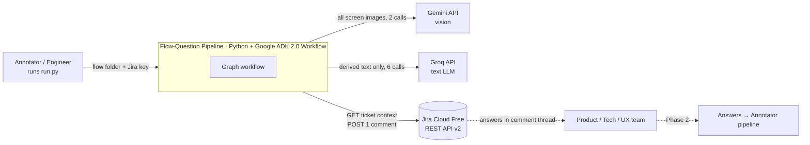
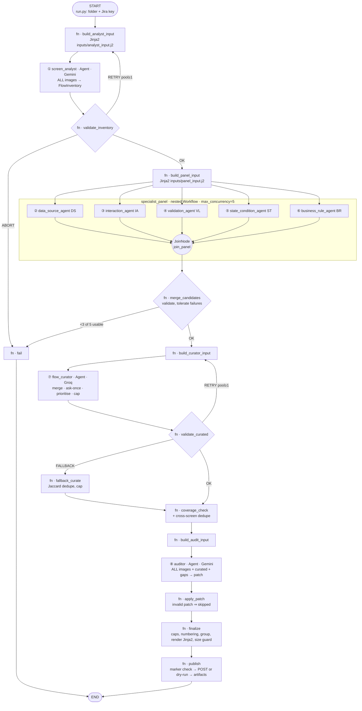

# Architecture — Flow-to-Questions Agentic Pipeline (Phase 1, v2)

> **One-line summary:** Take a **folder of screens that make up one flow** (e.g. Shopping: Cart → Shipping → Place order → Success) → analyze all screens together (Gemini, vision) → a **5-agent specialist panel** (Groq) drafts questions in parallel → a curator (Groq) merges them and **asks every common question only once** → an auditor (Gemini, vision) verifies against the images → post **one comment** on the flow's existing Jira ticket, organized as *Common questions* + *one section per screen*.

Orchestration is a **Google ADK 2.0 graph workflow** (`Workflow` with nodes and edges): LLM agents and plain-Python function nodes wired together, with parallel fan-out/join for the panel and routed retry/fallback paths.

---

## 1. Purpose and scope

### Problem
The annotation/engagement team manually joins calls with Product, UI/UX and Tech to work out, for each screen: where each field's data comes from, what each click does, validations, states and business rules. The answers are recorded in the Figma **Annotator** and drive the *Figma → React* pipeline.

### Phase 1 goal
1. Input: a **folder path** with the screen images of one flow (one flow = one Jira ticket).
2. Understand every screen **and how they relate** (transitions, shared components).
3. Produce a **small, unique, high-quality** question set: *common questions once*, screen-specific questions per screen.
4. Post it as **one Jira comment** on the existing flow ticket so PMO members can answer asynchronously.

### Out of scope (Phase 2+)
Reading answers back from Jira, generating Annotator annotations, real @mentions, ticket creation, API-catalog lookup (none exists yet).

---

## 2. What changed vs. v1

| Area | v1 | v2 |
|------|----|----|
| Input | 1 image | **Folder** of N images (1 flow, 1 ticket); single file still accepted (1-screen flow) |
| Analyst | 1 image → inventory | **All images in ONE Gemini call** → flow inventory (screens, transitions, **recurring components**) |
| Specialists | 3 (Data, Interaction, Rules) | **`specialist_panel` = 5**: DataSource (DS), Interaction (IA), Validation (VL), StateCondition (ST), BusinessRule (BR) |
| Dedupe | within one screen | **Across screens**: common questions asked once (`scope=FLOW`, "applies to S1, S2, S3") |
| Orchestration | custom `BaseAgent` | **ADK 2.0 graph `Workflow`** (nodes + edges, nested `specialist_panel`, `JoinNode`, routed retries) |
| LLM calls | 6 planned, cap 8 | **8 planned, cap 9** (2 Gemini + 6 Groq; 1 spare retry) — independent of screen count |
| Jira comment | grouped by owner | **Common section + per-screen sections**; owner tag on each question |

---

## 3. System context



Raw images go to Gemini only. Groq sees derived text only.

---

## 4. Key design decisions

| # | Decision | Rationale |
|---|----------|-----------|
| D1 | **8 planned LLM calls, hard cap 9**, enforced in code; planned count does **not** grow with number of screens | Multi-image input keeps vision at 2 calls; panel and curator see the whole flow at once. |
| D2 | **Gemini only for image calls** (analyst, auditor); **Groq only for text** (5 specialists, curator) | Matches the requirement; Groq is cheap/fast so a 5-way parallel panel is affordable. |
| D3 | **Analyst sees all screens in one call** and outputs one *flow inventory* incl. `transitions` and `recurring_components` | Cross-screen awareness is only possible if one model sees all screens; also avoids N vision calls. |
| D4 | **`specialist_panel`** = nested `Workflow` with 5 agents fanned out in parallel and joined by a `JoinNode`; non-overlapping lenses | Higher recall, less boilerplate; parallel ⇒ latency of one Groq call. |
| D5 | **Curator is flow-wide** (one call for all screens) and owns the "ask once" rule | Only a flow-wide view can collapse duplicates across screens. |
| D6 | **Auditor (Gemini + all images)** returns a patch only: add ≤3, remove, reword, rescope | Visual double-check without rewriting the list. |
| D7 | **Code does everything not requiring reasoning**: folder scan, image prep, JSON validation, cross-screen dedupe, coverage, caps, numbering, rendering, posting | Fewer LLM calls, testable behaviour. |
| D8 | **ADK 2.0 graph `Workflow`** for orchestration | Topology (fan-out, join, retry loops, fallbacks) is declared as edges instead of hidden in code or prompts; nested workflow gives the "panel" abstraction. |
| D9 | **Two kinds of Jinja2 templates**: `agents/*.j2` (system instructions, rendered once at build time) and `inputs/*.j2` (per-run user messages rendered inside function nodes) | Agent nodes receive the previous node's output as their user message, so dynamic data flows along edges naturally. |
| D10 | **Images are not stored in ADK state**; held in a `RunContext` closure and attached to Gemini requests by `before_model_callback` | Session state is serialized into events; binary blobs don't belong there. Text data flows via edges/state. |
| D11 | **Models come from `.env`** with per-agent overrides | Zero-code model swaps. |
| D12 | **Jira REST v2 wiki-markup comment**, plain-text `@product team` / `@tech team` / `@design team` | Works on free Jira Cloud; no real mentions needed in a POC. |
| D13 | **Idempotency marker** = hash of all images in order | Re-running the same flow doesn't spam the ticket (`--force` overrides). |

---

## 5. The graph



### Node catalog

| Node | Kind | LLM? | Responsibility |
|------|------|------|----------------|
| `build_analyst_input` | function | – | Render analyst user message (flow name hint, ordered screen list with filename hints, ticket context, repair hint on retry). |
| `screen_analyst` | Agent (Gemini) | ✔ #1 | Multi-image → `FlowInventory`. |
| `validate_inventory` | function/router | – | Parse + validate; route `OK` / `RETRY` / `ABORT`. |
| `build_panel_input` | function | – | Render shared panel message: inventory JSON + limits (per-specialist max, screens count). |
| `specialist_panel` | nested Workflow | ✔ #2–#6 | 5 agents in parallel → `JoinNode` (output keyed by agent name). |
| `merge_candidates` | function/router | – | Validate each agent's output, drop invalid candidates, tolerate failures (≥3 of 5 usable), tag `source_agents`. |
| `build_curator_input` | function | – | Render curator message: compact inventory, candidates, per-scope targets, caps. |
| `flow_curator` | Agent (Groq) | ✔ #7 | Global merge/dedupe, ask-once, priority, owner, wording. |
| `validate_curated` | function/router | – | Route `OK` / `RETRY` / `FALLBACK`. |
| `fallback_curate` | function | – | Deterministic dedupe/cap when curator unusable. |
| `coverage_check` | function | – | Cross-screen dedupe (code layer) + list of flagged elements/components with no question. |
| `build_audit_input` | function | – | Render auditor message. |
| `auditor` | Agent (Gemini) | ✔ #8 | Multi-image skeptical review → patch. |
| `apply_patch` | function | – | Apply valid patch ops; ignore invalid ones. |
| `finalize` | function | – | Caps, numbering, grouping, Jinja2 → Jira wiki markup, ≤30k char guard. |
| `publish` | function | – | Marker check, POST (or dry-run), write artifacts + run report. |
| `fail` | function | – | Record failure reason; CLI exits with code 2. |

State passed between nodes: text/JSON only, via `Event(output=…)` along edges and `Event(state={…})` for values needed later (`inventory`, `candidates`, `curated`, `warnings`, `retries_used`).

---

## 6. LLM call budget

| # | Node / agent | Model slot | Input | Output | Counted |
|---|--------------|-----------|-------|--------|---------|
| 1 | `screen_analyst` | `VISION_MODEL` (Gemini) | **all** images + hints | FlowInventory JSON | planned |
| 2 | `data_source_agent` (DS) | `TEXT_MODEL` (Groq) | inventory | candidates | planned (parallel) |
| 3 | `interaction_agent` (IA) | Groq | inventory | candidates | planned (parallel) |
| 4 | `validation_agent` (VL) | Groq | inventory | candidates | planned (parallel) |
| 5 | `state_condition_agent` (ST) | Groq | inventory | candidates | planned (parallel) |
| 6 | `business_rule_agent` (BR) | Groq | inventory | candidates | planned (parallel) |
| 7 | `flow_curator` | Groq | inventory + all candidates | final questions | planned |
| 8 | `auditor` | `VISION_MODEL` (Gemini) | **all** images + curated + gaps | patch | planned |
| 9 | *retry pool (1)* | – | – | repair of failed analyst, else curator | **only on failure** |

**Normal run = 8 calls (2 Gemini + 6 Groq). Worst case = 9. A 10th call is impossible** — `LLMBudget` short-circuits it in `before_model_callback`.

> **Note on the budget:** you asked for "+1 Groq call". Going from 3 to 5 specialists is +2 Groq calls over v1's plan (6 → 8 planned). That lands exactly on your original cap of 8, so the hard cap is set to **9 = 8 + the 1 extra call**, which is used as the single retry. If you want a strict 8 *including* retries, merge ST into IA (4 specialists → 7 planned + 1 retry).

Retry pool priority: analyst > curator. Specialists are never retried (the panel tolerates up to 2 failures); the auditor is never retried.

---

## 7. `specialist_panel` — five non-overlapping lenses

All five receive the **same** input (flow inventory + limits) but different system instructions. Each outputs `{"candidates":[…]}` with `source` = DS/IA/VL/ST/BR.

| Agent (tag) | Owns | Must NOT cover (owned by) |
|-------------|------|---------------------------|
| **DataSourceAgent (DS)** | Where each dynamic value comes from (endpoint path + method + response field, or other service), media/image service, formats (date/currency/units), list data behaviour (pagination, sort, filter, search), data shared across screens (cart, user, address), refresh/caching. | Click outcomes (IA), validation (VL), states (ST). |
| **InteractionAgent (IA)** | What each action does: API call, navigation target, modal/toast/redirect, back/cancel behaviour, **screen-to-screen transitions**, side effects. | Field rules (VL), conditions for enabled/visible (ST). |
| **ValidationAgent (VL)** | Input rules: required/optional, formats, lengths, masks (card number, postcode), when validation triggers (blur/submit), exact error messages, server-side error mapping. | Screen/component states (ST), business thresholds (BR). |
| **StateConditionAgent (ST)** | Component/screen **states and conditions**: loading, empty, error, success, disabled/enabled rules, conditional visibility, selected/expanded, stepper/progress, persistence of state across steps, timeouts/session expiry. | Input validation text (VL), business formulas (BR). |
| **BusinessRuleAgent (BR)** | Pricing/tax/shipping calculation, promo/coupon rules, limits/thresholds, eligibility, roles/permissions, region/locale rules, feature flags, analytics events, compliance. | Anything the design shows, API shapes (DS). |

Each agent returns at most `min(12, 2 + 2×N_screens)` candidates; fewer (or none) if nothing in its lens is unclear. The panel runs with `max_concurrency=PANEL_CONCURRENCY` (default 5; lower it if Groq free tier returns 429s).

---

## 8. Cross-screen "ask once" strategy

Example: *Shipping address* block appears on Checkout, Shipping and Place-order screens. We must ask "Where does the saved address come from? Is it editable here?" **once**, not three times.

Five layers, cheapest first:

1. **Analyst — `recurring_components`.** While looking at all images together it lists components that repeat (id `RC1`, name, `appears_on: [S1,S2,S3]`, element ids). Also lists `transitions` (S1 → S2 via "Continue").
2. **Specialists — scope rule.** If a question targets elements inside a recurring component (or data shown on several screens, e.g. cart total), emit **one** `scope=FLOW` question with `screens=[all appearances]` and `element_refs=["RC1"]`. Never emit the same question per screen.
3. **Curator — global merge.** Same intent across screens ⇒ one FLOW question with the union of screens. If behaviour may differ per screen, ask once and add "…and does it differ on <screen>?".
4. **Code — deterministic dedupe (`coverage_check`).** Merge when (a) same category and same recurring component, or (b) same category, different screens, token-Jaccard ≥ 0.6 ⇒ promote to FLOW with union of screens, keep the higher priority, union `source_agents`.
5. **Auditor — final sanity.** May `remove` (reason `duplicate`) or `rescope` (promote a screen question to FLOW with a screen list).

Single-screen run (N=1): FLOW scope is disabled; everything is `SCREEN`.

---

## 9. Question-quality strategy

1. **Lens separation** (5 agents) → recall without boilerplate.
2. **Element anchoring** — every question references element ids (`S2.E5`), a recurring component (`RC1`), a screen id, or `FLOW`; unanchored questions are dropped.
3. **Not-answerable-from-image** rule in specialists, curator and auditor.
4. **Answerability** — one decision per question, 1–3 sentence answer, with `answer_hint` ("endpoint, method, response field…").
5. **Bundling** — siblings with same behaviour ⇒ one question ("For Name, Phone and Pincode fields…").
6. **Complexity-scaled counts** — per-screen targets: low 2–3, medium 4–6, high 6–8 screen-specific questions; flow-level 2–8; hard caps `MAX_Q_PER_SCREEN`, `MAX_FLOW_Q`, `MAX_TOTAL_Q` (default 8 / 8 / 30) enforced in code.
7. **Coverage matrix + auditor** — flagged elements/components with no question are surfaced to the auditor (which sees the images) to fix or justify.

Category taxonomy aligned with the Annotator: `DATA_SOURCE`, `MEDIA`, `ACTION`, `NAVIGATION`, `VALIDATION`, `STATE`, `VISIBILITY`, `BUSINESS_RULE`, `PERMISSION`, `CONTENT`.

---

## 10. Model strategy (`.env`-driven)

```
VISION_MODEL=gemini-…          # analyst + auditor      (must be Gemini)
TEXT_MODEL=groq/…              # 5 specialists + curator (must be groq/…)
MODEL_ANALYST= MODEL_AUDITOR= MODEL_SPECIALISTS= MODEL_CURATOR=   # optional overrides
```

`models.py`: `gemini-*` → plain string for `Agent(model=…)`; `groq/*` → `LiteLlm(model="groq/…")`. Startup validation fails fast if a vision slot isn't Gemini or a text slot isn't Groq. Example model IDs in `.env.example` should be re-checked against the current provider model lists.

---

## 11. Prompts and Jinja2

```
templates/
├── agents/   # system instructions — rendered ONCE when agents are built
│   ├── analyst.j2   specialist_base.j2   ds.j2 ia.j2 vl.j2 st.j2 br.j2   curator.j2   auditor.j2
├── inputs/   # per-run user messages — rendered INSIDE function nodes
│   ├── analyst_input.j2   panel_input.j2   curator_input.j2   auditor_input.j2
└── jira_comment.j2
```

- ADK agent nodes receive the previous node's output as their user message, so each `build_*_input` function renders an `inputs/*.j2` template and passes the text down the edge.
- `specialist_base.j2` holds the shared rules (ask-once, anchoring, limits); `ds/ia/vl/st/br.j2` `` it and fill ``.
- `StrictUndefined` everywhere so a missing variable fails tests, not production.
- `jira` filter escapes wiki-markup characters in LLM text.

---

## 12. Failure handling (graph routes)

| Failure | Route / behaviour |
|---------|-------------------|
| Analyst invalid JSON / schema | `RETRY` once if pool left (loop edge to `build_analyst_input` with repair hint) else `ABORT` → `fail` (exit 2, nothing posted). |
| Analyst returns fewer screens than images | Treated as invalid (same path). |
| 1–2 specialists fail/invalid | Proceed with warning (≥3 of 5 usable). |
| <3 specialists usable | `ABORT`. |
| Curator invalid | `RETRY` once if pool left, else `FALLBACK` → `fallback_curate`. |
| Auditor fails / invalid patch | Skip patch; post curated list; warning in report. |
| Budget exhausted | `before_model_callback` returns stub JSON `{"error":"budget_exhausted"}`; node output fails validation → rules above. |
| Model/API error inside a panel agent | `on_model_error_callback` returns stub so `JoinNode` still completes (join needs every branch to produce output). |
| Comment > 30,000 chars | `finalize` drops lowest-priority questions until it fits (warning). |
| Jira 4xx/5xx on POST | Comment text already saved to `outputs/`; exit 3; no automatic re-POST (avoids duplicates). |
| Marker already on ticket | Skip posting (exit 0) unless `--force`. |

---

## 13. Jira integration and comment layout

- **Auth:** Jira Cloud free — `JIRA_EMAIL` + `JIRA_API_TOKEN` (Basic), `JIRA_BASE_URL`.
- **Read (no LLM):** `GET /rest/api/2/issue/{key}?fields=summary,description` → ≤1500-char `ticket_context` (flow name, scope hints).
- **Idempotency:** `GET …/comment` and look for the marker.
- **Write:** `POST /rest/api/2/issue/{key}/comment` — **exactly one comment** per run, on the existing flow ticket.
- **Owners:** plain text `@product team`, `@tech team`, `@design team` (no notifications; real mentions in Phase 2).
- **No API catalog:** never invent endpoints; data questions ask the PMO for endpoint, method and response field.

**Comment layout**

```
h2. Clarification questions — <Flow name> (<N> screens)
Hi @tech team, @product team — …
Flow summary · Screens: S1 Cart · S2 Shipping · S3 Place order · S4 Success
Who answers what: @tech team → Q1, Q2, Q5 … · @product team → Q3, Q4 …

h3. Common to multiple screens — answer once
Q1 [DATA_SOURCE] Shipping address block — applies to: Cart, Shipping, Place order · Owner: @tech team
…
h3. Screen 1 — Cart
Q6 …
h3. Screen 2 — Shipping
Q9 …
----
Reply under this comment using question numbers (e.g. "Q1: …").  · run <id> · marker
```

Numbering is sequential across the whole comment (common first, then screens in flow order) so replies like `Q7:` are unambiguous and Phase 2 can parse them.

---

## 14. Project structure

```
screen-questions/
├── run.py                     # 3-line shim → src.cli.main()
├── .env.example  requirements.txt  README.md
├── src/
│   ├── cli.py                 # args, env precedence, run Workflow via Runner, exit codes
│   ├── config.py              # Settings (dotenv + pydantic), slot validation
│   ├── models.py              # Gemini / LiteLlm(Groq) factory
│   ├── schemas.py             # FlowInventory, Candidate, Question, AuditPatch, RunReport
│   ├── run_context.py         # RunContext: settings, images (bytes/parts), budget, report log
│   ├── budget.py              # LLMBudget + before/after/error model callbacks
│   ├── prompts.py             # Jinja2 env, render_agent(), render_input(), `jira` filter, extract_json()
│   ├── agents.py              # builds 8 Agent nodes (+ nested specialist_panel Workflow)
│   ├── nodes.py               # function nodes / routers (closed over RunContext)
│   ├── workflow.py            # the edge list — the whole topology in one file
│   ├── postprocess.py         # merge, cross-screen dedupe, coverage, fallback, patch, caps, numbering
│   ├── image_utils.py         # folder scan (natural sort), validate, resize, sha, Parts
│   ├── jira_client.py         # get_issue_context, has_marker, post_comment
│   └── templates/ …
├── tests/
└── outputs/<KEY>_<ts>/        # flow_inventory.json, candidates.json, curated.json, audit.json,
                               # comment.txt, run_report.json
```

---

## 15. Observability, cost, latency

- Callbacks log every model call (agent, model, seconds, tokens) → `run_report.json` (`llm_calls`, per-call table, models used, warnings).
- Typical latency for a 4-screen flow: analyst 10–20 s → panel (parallel) 3–8 s → curator 5–10 s → auditor 8–15 s → Jira ~1 s ⇒ **~30–60 s**.
- Cost: 2 multi-image Gemini calls + 6 Groq calls per *flow* — the vision cost scales with total image tokens, not with call count.

---

## 16. Security and privacy

- Secrets only in `.env`; never logged.
- Images → Gemini only; Groq gets derived text.
- Check provider data-use terms (free tiers may use inputs to improve products) before running confidential client designs.
- Dedicated least-privilege Jira token.

---

## 17. Risks and open questions

| Risk | Mitigation |
|------|------------|
| ADK 2.0 graph API details (loops/multi-inbound edges, nested workflow input, join with a failed branch, Groq via LiteLlm in agent nodes) | **Spike M0**; documented fallback: one *dynamic* node using `ctx.run_node` + `asyncio.gather` + Python loops for the same stages (ADK's dynamic-workflow mode, marked alpha in the docs). |
| 5 parallel Groq calls hit free-tier rate limits | `PANEL_CONCURRENCY` (maps to Workflow `max_concurrency`); HTTP backoff at client level. |
| Multi-image analyst misses a screen or mislabels one | Validation: #screens == #images, ids match file order; screen names fall back to filename stems. |
| Screens that differ subtly (e.g., "address" looks the same but is a different component) | Curator adds "does this differ on …?" wording; annotators review golden set. |
| Too many questions for large flows | Caps in code; per-screen & flow-level limits; P2 dropped first. |
| Order of files ≠ flow order | Convention: prefix filenames `01_`, `02_`…; natural sort; analyst also reports inferred `transitions`. |
| **Open:** max screens per flow | Default 8; larger flows should be split across tickets. |
| **Open:** `@design team` vs fold UI/UX into `@product team` | Confirm with the team. |

---

## 18. Phase 2 hooks

Stable `Q` numbers + `answer_hint` + category taxonomy → parse PMO replies and map to Annotator fields; marker hash → detect "flow changed"; skip questions already answered in earlier comments; API-catalog lookup node inserted before the panel; real mentions via label→accountId map.

---

## 19. References

- Google Cloud blog — *Graph Workflows in ADK: Everything You Need to Know* (fan-out/`JoinNode`, routing with `Event(route=…)`, nested workflows, `parallel_worker`, dynamic `ctx.run_node`).
- Google Codelab — *Agentic workflow with ADK* (edge tuples, `START`, `JoinNode`, router nodes, agent modes, callbacks on agent nodes, function-node state binding).
- ADK docs — dynamic workflows (alpha) at adk.dev.
